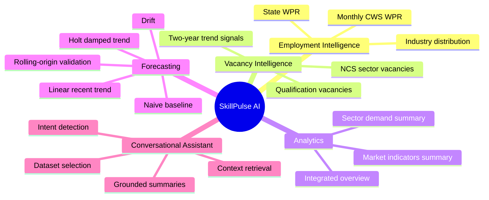
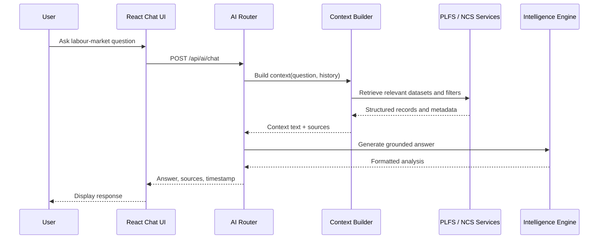
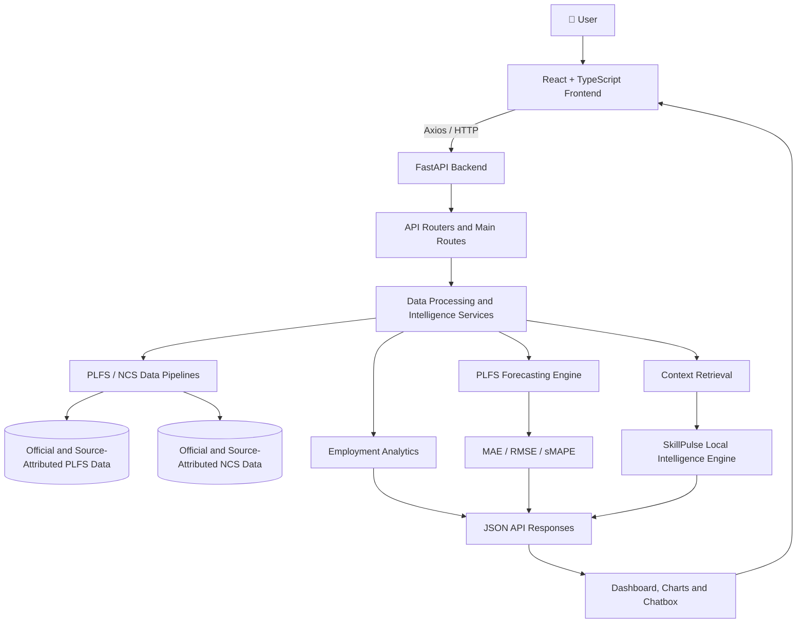

<div align="center">

# 🇮🇳 SkillPulse AI

### **Understanding Today's Workforce. Predicting Tomorrow's Needs. Building a Skill-Ready India.**

[](#technology-stack)
[](#technology-stack)
[](#technology-stack)
[](#technology-stack)
[](#technology-stack)

**Repository:** [Vansh-Chauhan1/Skill-pulse-ai-final](https://github.com/Vansh-Chauhan1/Skill-pulse-ai-final)

**Live Demo:** ⚠️ _Awaiting deployment — no public live URL is configured yet._

</div>

---

## 🚀 At a Glance

**SkillPulse AI** is an AI-powered labour-market intelligence platform that brings employment indicators, public vacancy information, regional employment patterns, sector demand signals, and exploratory forecasting into one interactive experience.

The platform combines a **React + TypeScript dashboard** with a **FastAPI backend**, official-source PLFS and NCS datasets, statistical forecasting, and a grounded contextual assistant. It is designed to help users explore evidence, not replace official labour-market statistics or act as a guaranteed predictor.

> [!IMPORTANT]
> Some legacy skill-gap endpoints and prototype visualizations use an illustrative CSV. These outputs are **not official national skill-gap statistics** and are kept for compatibility with the existing application.

---

## 🧭 Table of Contents

- [The Problem](#-the-problem)
- [Our Solution](#-our-solution)
- [Key Features](#-key-features)
- [How the AI Works](#-how-the-ai-works)
- [Forecasting Methodology](#-forecasting-methodology)
- [Data Sources](#-data-sources)
- [Technology Stack](#-technology-stack)
- [System Architecture](#-system-architecture)
- [Project Directory Structure](#-project-directory-structure)
- [Installation and Local Setup](#-installation-and-local-setup)
- [API Documentation](#-api-documentation)
- [Forecasting Limitations and Data Disclaimer](#-forecasting-limitations-and-data-disclaimer)
- [Target Users](#-target-users)
- [Future Roadmap](#-future-roadmap)
- [Contribution and License](#-contribution-and-license)

---

## 🔴 The Problem

India's workforce information is difficult to interpret as a single, decision-ready picture:

- **Skill mismatch:** Job seekers and training systems may not align with sectors and qualifications employers need.
- **Education-industry disconnect:** Educational outcomes are not consistently connected to verified employment demand.
- **Regional differences:** Employment indicators vary by state, rural/urban location, gender, and age.
- **Fragmented datasets:** PLFS employment observations and NCS vacancy records use different units, universes, and reporting periods.
- **Limited future intelligence:** Historical statistics alone do not provide accessible, explainable short-term trend signals.

A responsible platform must therefore distinguish observations, calculations, prototype outputs, and exploratory forecasts instead of mixing them into one unsupported conclusion.

---

## 💡 Our Solution

SkillPulse AI turns structured labour-market data into an integrated, explainable experience:

1. **Visualize** state-level PLFS Worker Population Ratios and regional employment patterns.
2. **Explore** NCS sector-wise and qualification-wise vacancy information.
3. **Compare** short historical employment and vacancy trends.
4. **Validate** candidate monthly WPR forecasts using rolling-origin backtesting and standard error metrics.
5. **Ask questions** through a contextual assistant grounded in retrieved labour-market datasets.
6. **Consolidate** available indicators through a unified market-intelligence overview.

The system is intentionally grounded: it does not estimate a skill gap merely by subtracting incompatible percentages or vacancy counts.

---

## ✨ Key Features

| Status | Feature | Implementation notes |
|---|---|---|
| ✅ Implemented | Interactive India map | React frontend uses map components and state-level data views. |
| ✅ Implemented | State-wise employment analysis | PLFS state Worker Population Ratio records are available through the API and dashboard. |
| ✅ Implemented | PLFS employment indicators | State WPR, All-India industry distribution, and monthly CWS WPR datasets are loaded. |
| ✅ Implemented | NCS vacancy analysis | Sector, qualification, and summary vacancies are exposed through dedicated endpoints. |
| ✅ Implemented | Sector-demand trend signals | The backend compares FY 2022–23 and FY 2023–24 NCS sector data with descriptive classifications. |
| ✅ Implemented | Integrated market intelligence | `/api/intelligence/overview` combines selected PLFS/NCS indicators and optional forecasts. |
| ✅ Implemented | Statistical forecasting | Naive, drift, recent six-period linear trend, and damped Holt trend candidates are implemented. |
| ✅ Implemented | Holt damped trend scenario | A separate dynamic Holt scenario is generated and clearly identified as alternative. |
| ✅ Implemented | Naive baseline comparison | The lowest-error rolling-origin model is selected as the primary forecast; it may be a flat naive forecast. |
| ✅ Implemented | Forecast validation | Expanding-window backtesting reports MAE, RMSE, and sMAPE. |
| ✅ Implemented | Conversational AI assistant | The local assistant detects intent, retrieves relevant context, and produces grounded natural-language summaries. |
| ⚠️ Prototype/sample | Legacy skill-gap analytics | `/api/skill-gaps`, state, industry, skill, shortage, surplus, and `/api/predict` use a small illustrative employment CSV. |
| ⚠️ Illustrative | Legacy prediction model | A model artifact and training script exist, but they must not be presented as official or validated national skill-gap modelling. |
| 🧭 Future | Personalized career guidance | Not implemented as a user-specific recommendation engine. |

### Feature Overview



---

## 🤖 How the AI Works

SkillPulse AI does **not** train or claim to operate a large language model in this repository.

The implementation is a **domain-specific, local intelligence engine**. The `ai_service.py` module:

1. Detects the user's intent: forecast, demand, employment, skills, state analysis, comparison, or overview.
2. Builds a relevant context package using `ai_context.py` and the loaded PLFS/NCS services.
3. Extracts structured JSON data blocks and selects records relevant to the question.
4. Formats and summarizes the retrieved data.
5. Applies explicit limitations, such as not interpreting WPR as an unemployment rate or NCS vacancies as complete national demand.

### Context Retrieval Flow



<details>
<summary><strong>Important implementation distinction</strong></summary>

The backend environment still contains optional LLM-provider configuration fields in `.env.example`, but the actual current `llm_status()` implementation reports:

- Provider: `skillpulse-local`
- Model: `SkillPulse Intelligence Engine`

The response generator in `ai_service.py` performs intent detection and deterministic formatting from retrieved records. It is not calling an external LLM in the current implementation inspected.

</details>

### Conversational AI vs Forecasting

| Capability | Purpose | Method |
|---|---|---|
| Conversational assistant | Explain, compare, and summarize retrieved labour-market context | Intent detection + contextual dataset retrieval + local formatting engine |
| Forecasting | Produce a short-term exploratory WPR estimate | Naive and trend statistical methods + rolling-origin validation |
| Skill-gap analytics | Prototype compatibility features | Small illustrative CSV and existing model artifact |

---

## 📈 Forecasting Methodology

The forecast module uses the All-India rural-and-urban combined monthly CWS Worker Population Ratio for persons aged 15 years and above.

### Candidate Methods

| Method | Behavior |
|---|---|
| Naive | Repeats the latest historical value for each forecast month. |
| Drift | Extends the overall first-to-last linear change. |
| Linear recent trend | Fits least squares over the latest six observations. |
| Holt damped trend | Uses additive level and damped trend with tuned smoothing parameters. |

### Validation

- **Minimum initial training size:** 8 observations
- **Method:** expanding-window rolling-origin validation
- **Step:** one-month-ahead forecast
- **Primary model selection:** lowest rolling-origin MAE, with RMSE used as a comparison tie-breaker
- **Primary horizon:** configurable from 1 to 3 months

### Metrics

| Metric | Meaning |
|---|---|
| MAE | Mean absolute error in WPR percentage points. |
| RMSE | Root mean squared error, giving more weight to larger errors. |
| sMAPE | Symmetric mean absolute percentage error, shown as a percentage. |

The API returns:

- The lowest-error selected baseline forecast
- The Holt damped-trend scenario
- Candidate model comparisons
- Backtest predictions
- Historical observations
- Source documents and URLs
- A methodology warning

> Forecasts are **exploratory statistical estimates**, not guaranteed outcomes or official government projections. They do not directly forecast vacancies, skill gaps, or employment headcounts.

---

## 🗂️ Data Sources

### Official source data

| Source | Coverage | Repository file family | Interpretation |
|---|---|---|---|
| Periodic Labour Force Survey (PLFS) 2023–24 | State WPR, industry distribution, monthly CWS WPR | `skillpulse_official_data_pack/raw/plfs/` and `backend/data/raw/plfs/` | Official report values or source-attributed observations. WPR is a percentage, not a worker headcount. |
| National Career Service (NCS) | Sector and qualification vacancies for FY 2022–23 and FY 2023–24 | `skillpulse_official_data_pack/raw/ncs/` and `backend/data/raw/ncs/` | Vacancies mobilised through the NCS platform, not all vacancies in India. |

Official reports in the repository's data dictionary:

- [PLFS Annual Report 2023–24](https://mospi.gov.in/sites/default/files/publication_reports/AnnualReport_PLFS2023-24L2.pdf)
- [NCS Comparative Statistics FY 2022–23 and FY 2023–24](https://www.ncs.gov.in/Documents/NCS-Statistics-2022-23-24.pdf)

### Data Classification

| Type | Examples | Allowed interpretation |
|---|---|---|
| Official observations | PLFS state WPR; PLFS industry shares; NCS published vacancy counts | Reported values from source documents |
| Calculated indicators | Sector trend signals; compact market indicators; MAE/RMSE/sMAPE | Derived by implemented code from source observations |
| Exploratory forecasts | Holt and selected-model WPR forecasts | Short-term statistical scenarios, subject to uncertainty |
| Illustrative sample data | `backend/data/employment_data.csv` | Prototype-only demonstration; not official skill-gap statistics |

> [!CAUTION]
> PLFS WPR percentages, NCS vacancy counts, and skill supply cannot be combined as if they shared the same unit or population. The repository data dictionary explicitly warns against converting WPR into worker counts or subtracting it from vacancies.

---

## 🧰 Technology Stack

### Application Stack

| Category | Technology | Where it is used |
|---|---|---|
| Frontend | React 19 | Dashboard and chat interface |
| Frontend language | TypeScript | Typed React application |
| Build tool | Vite | Frontend development and production build |
| Routing | React Router | Client-side navigation |
| HTTP client | Axios | API communication |
| Charts | Recharts | Dashboard visualizations |
| Maps | React Leaflet, Leaflet, React Simple Maps | Interactive geographical views |
| Markdown rendering | React Markdown, Remark GFM | Assistant response presentation |
| Backend | Python | API, data processing, analytics |
| API framework | FastAPI | HTTP endpoints and OpenAPI documentation |
| Server | Uvicorn | ASGI development server |
| Data processing | Pandas, NumPy | CSV processing and statistical calculations |
| Local AI/analytics | SkillPulse Intelligence Engine | Context selection and formatted local responses |

### Additional Backend Files

The backend requirements also include `python-dotenv`, `httpx`, and `openai`; do not interpret their presence as evidence that the current assistant calls an external OpenAI model. The local assistant implementation reports `skillpulse-local` and does not require an external LLM key for its current deterministic response path.

---

## 🏗️ System Architecture



The compact data pipeline normalizes indicators while preserving source units and scope. Forecasting is separate from conversational answering, and the assistant adds retrieved data as context rather than training or fine-tuning a model.

---

## 📁 Project Directory Structure

```text
Skill-pulse-ai-final/
├── backend/
│   ├── analysis/                 # Additional analysis resources
│   ├── data/                     # Runtime CSV datasets, metadata and raw official files
│   │   ├── employment_data.csv   # Illustrative legacy skill-gap prototype data
│   │   ├── ml_features.csv       # Legacy/sample feature data
│   │   ├── metadata/             # Source metadata
│   │   ├── raw/                  # Backend-runtime PLFS and NCS files
│   │   └── processed/            # Processed data artifacts
│   ├── ml/                       # Forecasting and legacy model files
│   │   ├── plfs_forecasting.py
│   │   ├── predictor.py
│   │   ├── skill_gap_model.pkl
│   │   └── train_model.py
│   ├── routers/
│   │   └── ai.py                 # AI health, chat and forecast interpretation routes
│   ├── services/
│   │   ├── ai_context.py         # Dataset/context selection
│   │   ├── ai_service.py         # Local intent and response engine
│   │   ├── compact_market_data.py
│   │   ├── intelligence_engine.py
│   │   ├── official_data.py
│   │   ├── sector_demand_engine.py
│   │   └── skill_gap.py
│   ├── schemas/                  # Pydantic and API schema resources
│   ├── tests/                    # Backend tests
│   ├── main.py                   # FastAPI application entry point
│   ├── requirements-analytics.txt
│   ├── .env.example
│   ├── run_checks.ps1
│   └── skillpulse_api_smoke_test.ps1
├── frontend/
│   ├── public/                   # Static public assets
│   ├── src/
│   │   ├── components/
│   │   │   ├── chat/             # Chat UI components
│   │   │   ├── EmploymentDashboard.tsx
│   │   │   ├── IndiaSkillMap.tsx
│   │   │   └── BackendStatus.tsx
│   │   ├── pages/
│   │   │   └── Dashboard.tsx
│   │   ├── services/             # Frontend API service modules
│   │   ├── types/                # TypeScript types
│   │   ├── App.tsx
│   │   └── main.tsx
│   ├── package.json
│   └── vite.config.ts
├── skillpulse_official_data_pack/
│   ├── raw/plfs/
│   ├── raw/ncs/
│   ├── metadata/
│   └── README_DATA_DICTIONARY.md
├── package.json                  # Root convenience scripts
├── package-lock.json
└── .gitignore
```

> The repository also contains committed virtual-environment and `node_modules` directories; these are not recommended as a fresh setup path and should be excluded or removed in future repository cleanup.

---

## 🛠️ Installation and Local Setup

### Prerequisites

- Python 3.10 or newer recommended
- Node.js 18 or newer recommended
- npm
- Git

### 1. Clone the repository

```bash
git clone https://github.com/Vansh-Chauhan1/Skill-pulse-ai-final.git
cd Skill-pulse-ai-final
```

### 2. Configure the backend

**Windows (PowerShell):**

```powershell
cd backend
python -m venv .venv
.\.venv\Scripts\Activate.ps1
python -m pip install --upgrade pip
python -m pip install -r requirements-analytics.txt
copy .env.example .env
uvicorn main:app --reload --host 127.0.0.1 --port 8000
```

**macOS/Linux:**

```bash
cd backend
python3 -m venv .venv
source .venv/bin/activate
python -m pip install --upgrade pip
python -m pip install -r requirements-analytics.txt
cp .env.example .env
uvicorn main:app --reload --host 127.0.0.1 --port 8000
```

Backend API documentation: [http://127.0.0.1:8000/docs](http://127.0.0.1:8000/docs)

### 3. Configure environment variables

Edit `backend/.env`. The current local assistant does not use external LLM keys.

| Variable | Purpose | Example |
|---|---|---|
| `LLM_PROVIDER` | Reserved provider setting in the example configuration | `openai` |
| `LLM_API_KEY` | External provider key, if an external provider is later enabled | `<secret>` |
| `LLM_MODEL` | External model identifier, if used | `<model>` |
| `FRONTEND_ORIGINS` | Comma-separated extra frontend origins | `https://example.com` |
| `LLM_TIMEOUT_SECONDS` | Optional timeout setting | `45` |
| `LLM_MAX_TOKENS` | Optional token setting | `1500` |
| `AI_RATE_LIMIT_PER_MINUTE` | Per-client chat limiter | `15` |
| `AI_DEBUG_CONTEXT` | Enables `/api/ai/debug-context` | `false` |

Never commit real API keys or the `.env` file.

### 4. Configure and start the frontend

Open a second terminal:

```bash
cd frontend
npm install
```

Create `frontend/.env.local` if you need a custom backend URL:

```dotenv
VITE_API_BASE_URL=http://127.0.0.1:8000
```

Start the frontend:

```bash
npm run dev
```

The Vite development server normally runs at [http://localhost:5173](http://localhost:5173). The frontend defaults to `http://127.0.0.1:8000` during local development when `VITE_API_BASE_URL` is not set.

### 5. Optional backend checks

From `backend/`:

```bash
python -m ml.plfs_forecasting
```

Windows PowerShell helpers are also present:

```powershell
.\run_checks.ps1
.\skillpulse_api_smoke_test.ps1
```

---

## 📡 API Documentation

The main FastAPI application is in `backend/main.py`. Interactive OpenAPI documentation is available at `/docs`.

### Core and health

| Endpoint | Method | Purpose |
|---|---|---|
| `/` | GET | Basic project and documentation status |
| `/api/health` | GET | Backend health status |

### AI assistant

| Endpoint | Method | Purpose |
|---|---|---|
| `/api/ai/health` | GET | AI engine/status information |
| `/api/ai/chat` | POST | Grounded labour-market question and answer |
| `/api/ai/forecast-interpretation` | GET | Generate a formatted interpretation of the PLFS forecast |
| `/api/ai/debug-context` | POST | Development-only retrieved-context inspection; disabled unless `AI_DEBUG_CONTEXT=true` |

### Official PLFS and NCS data

| Endpoint | Method | Purpose |
|---|---|---|
| `/api/official/plfs/state-wpr` | GET | State-wise PLFS WPR records |
| `/api/official/plfs/industry-distribution` | GET | All-India PLFS industry distribution |
| `/api/official/plfs/monthly-cws-wpr` | GET | Monthly All-India CWS WPR observations |
| `/api/official/plfs/wpr-forecast` | GET | 1–3 month exploratory WPR forecast; horizon query parameter |
| `/api/official/ncs/sector-vacancies` | GET | NCS sector vacancy records |
| `/api/official/ncs/qualification-vacancies` | GET | NCS qualification vacancy records |
| `/api/official/ncs/summary` | GET | NCS headline statistics |

### Analytics and intelligence

| Endpoint | Method | Purpose |
|---|---|---|
| `/api/analytics/market-indicators` | GET | Filtered normalized market indicators |
| `/api/analytics/market-indicators/summary` | GET | Compact-pipeline data-quality report |
| `/api/analytics/sector-demand-trends` | GET | Two-year NCS sector trend classifications; optional `signal` filter |
| `/api/analytics/sector-demand-trends/summary` | GET | Summary of sector trend classifications |
| `/api/intelligence/overview` | GET | Consolidated PLFS/NCS view with optional forecast horizon |

### Prototype compatibility endpoints

| Endpoint | Method | Purpose | Data status |
|---|---|---|---|
| `/api/skill-gaps` | GET | Illustrative skill-gap rows | Small sample CSV |
| `/api/states` | GET | State-level prototype aggregation | Illustrative |
| `/api/industries` | GET | Industry-level prototype aggregation | Illustrative |
| `/api/skills` | GET | Prototype demanded-skill totals | Illustrative |
| `/api/shortages` | GET | Prototype shortage rows | Illustrative |
| `/api/surpluses` | GET | Prototype surplus rows | Illustrative |
| `/api/predict` | GET | Prototype demand-versus-workers prediction | Illustrative model behavior; not an official skill-gap estimate |

---

## ⚠️ Forecasting Limitations and Data Disclaimer

- Historical PLFS observations are limited in length and may not capture structural shocks or policy changes.
- A short or volatile series can legitimately select a naive flat baseline after validation.
- Rolling-origin backtesting evaluates past performance; it is not a confidence interval or guarantee of future accuracy.
- MAE and RMSE do not make a forecast official or causally valid.
- Holt trend values are alternative scenarios, not a more accurate result unless backtesting supports them.
- PLFS and NCS use different reporting universes and units.
- NCS vacancies represent vacancies mobilised through the platform, not a census of Indian vacancies.
- PLFS WPR is an employment-to-population indicator; it is not an unemployment rate or a direct measure of skill demand.
- The repository's legacy sample data must not be described as official national skill-gap statistics.
- A genuine skill-level gap requires aligned occupation, skill, geography, population, time period, and employer-demand evidence.

---

## 🎯 Target Users

| User group | Value |
|---|---|
| Students | Explore employment indicators and sector vacancy context before choosing skills or career pathways. |
| Educational institutions | Compare regional and sector signals to improve curriculum and placement planning discussions. |
| Industries and employers | Review public labour-market context alongside their own hiring evidence. |
| Policymakers | Examine state employment differences and two-year NCS sector patterns as decision-support inputs. |

---

## 🖼️ Screenshots

> Replace these placeholders with real application images after deployment or local capture.

### Dashboard

<!-- Screenshot placeholder: Add a 16:9 image of the React dashboard here -->

<p align="center">
  <em>Dashboard screenshot — awaiting capture</em>
</p>

### India Employment Map

<!-- Screenshot placeholder: Add a state-selection and map-visualization image here -->

<p align="center">
  <em>Interactive India map screenshot — awaiting capture</em>
</p>

### AI Assistant

<!-- Screenshot placeholder: Add a grounded chat response with sources here -->

<p align="center">
  <em>Conversational assistant screenshot — awaiting capture</em>
</p>

---

## 🧭 Future Roadmap

The following items are **future possibilities**, not verified existing features:

- [ ] Add more official datasets and reporting periods.
- [ ] Build documented skill-demand crosswalks across occupations and education sectors.
- [ ] Improve state and district-level skill-demand analysis with defensible denominators.
- [ ] Add more rigorous forecasting methods and uncertainty intervals.
- [ ] Add longer rolling-origin backtests and model-selection safeguards.
- [ ] Add personalized career guidance with explicit user consent and transparent assumptions.
- [ ] Add industry-specific vacancy and workforce dashboards.
- [ ] Improve source provenance and data-quality monitoring.
- [ ] Evaluate optional external LLM integration, but keep deterministic context grounding and source attribution.

---

## 🤝 Contribution and License

### Contributing

Contributions are welcome, especially improvements to:

- Data provenance and source validation
- Forecasting methodology and tests
- API validation and error handling
- Frontend accessibility and visualizations
- Documentation and reproducible setup
- Removal of ambiguous prototype/sample labels

Suggested workflow:

1. Fork the repository.
2. Create a focused feature or fix branch.
3. Keep official data, illustrative data, and forecasting outputs clearly separated.
4. Run relevant backend tests and the frontend build.
5. Open a pull request describing data sources and technical validation.

### License

No repository-level license was detected by GitHub at the time of inspection. Until a license is explicitly added by the maintainer, the code should be treated as **all rights reserved** rather than assumed open source.

---

## 🌟 Final Project Statement

**SkillPulse AI is not just about understanding where India's workforce stands today. It is about preparing India for where its workforce needs to be tomorrow.**

<div align="center">

[Back to Top](#-skillpulse-ai)

</div>
